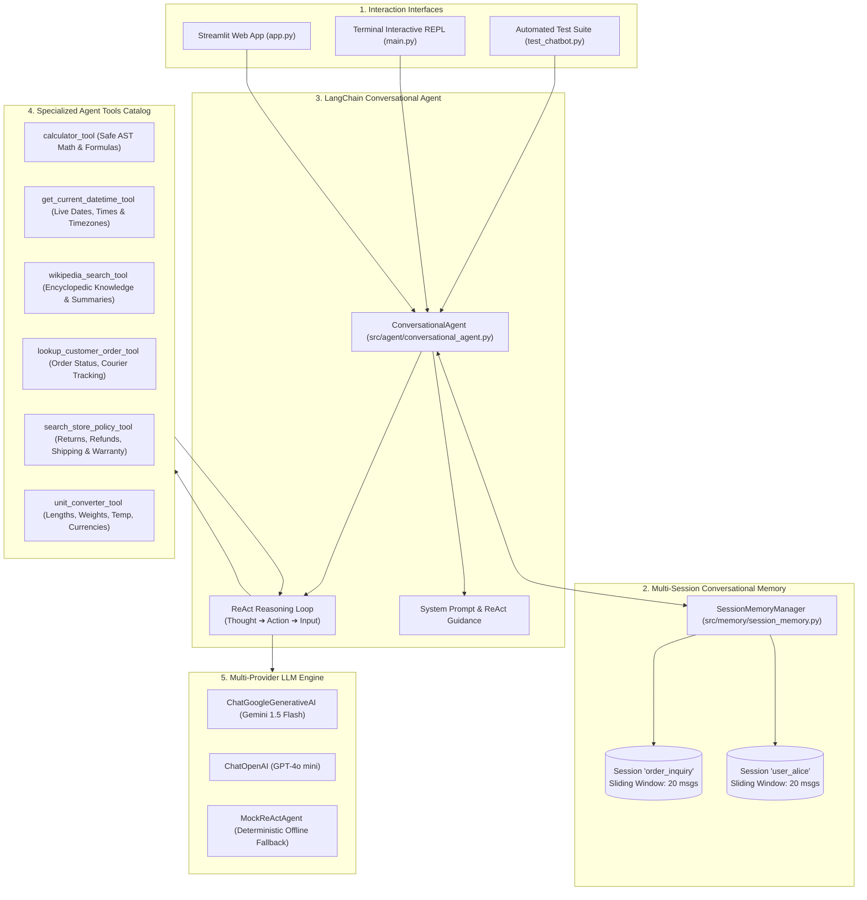

# Agents and Tools - Resource - 2: Build a Conversational Chatbot using LangChain

A production-grade, multi-turn **Conversational Chatbot** powered by **LangChain Agents & Tools**, featuring persistent multi-session memory, autonomous tool routing, ReAct reasoning traceability, and multi-provider resilience (Google Gemini, OpenAI, and Deterministic Offline ReAct).

---

## 🏛️ System Architecture



---

## 🚀 Key Capabilities

1. **Autonomous Tool Routing**: The agent autonomously analyzes the user query, determines whether specialized tools are necessary, selects the proper tool, and executes it.
2. **Multi-Turn Conversational Memory**:
   - Maintains contextual continuity across turns (e.g. Turn 1: user introduces name or asks about an order; Turn 2: agent resolves pronouns and follow-up references).
   - Strict session isolation ensures conversations in `session_A` never bleed into `session_B`.
3. **Enterprise Domain Tools**:
   - `calculator_tool`: Safe AST expression evaluation (addition, multiplication, powers, square roots, trigonometric functions).
   - `get_current_datetime_tool`: Live ISO timestamps, date formats, and worldwide timezone awareness.
   - `wikipedia_search_tool`: Direct encyclopedia search and multi-sentence summary extraction.
   - `lookup_customer_order_tool`: Real-time order tracking (`ORD-1001`, `ORD-1002`, `ORD-1004`), shipping addresses, items, and carrier details.
   - `search_store_policy_tool`: Fast lookup for returns, refunds, shipping times, and warranties.
   - `unit_converter_tool`: Instant conversions for temperatures (C/F/K), lengths (km/miles/feet), weights (kg/lbs), and currencies (USD/EUR/INR/GBP/JPY).
4. **ReAct Thought & Execution Traceability**: Inspect the model's inner monologue:
   - **Thought**: Reasoning about why a tool is required.
   - **Action**: Tool name selected.
   - **Action Input**: Exact arguments passed.
   - **Observation**: Output returned by the tool.
   - **Final Answer**: Human-friendly synthesized response.
5. **Multi-Provider & Zero-Credential Resilience**:
   - Configurable for **Google Gemini** (`gemini-1.5-flash`), **OpenAI** (`gpt-4o-mini`), or automatic detection.
   - Seamlessly falls back to an offline deterministic ReAct engine if API keys are absent, ensuring immediate usability and 100% test pass rate without network dependencies.

---

## 📂 Repository Structure

```
AI_Bot/
├── .env.example                 # Environment configuration template
├── requirements.txt             # Frozen dependencies
├── README.md                    # System documentation and guide
├── app.py                       # Streamlit Conversational AI Web Application
├── main.py                      # Interactive Command-Line Interface (CLI REPL)
├── test_chatbot.py              # Automated Unit & Integration Test Suite
└── src/
    ├── __init__.py              # Package initialization
    ├── config.py                # Centralized settings and environment loader
    ├── tools/                   # Specialized agent tools
    │   ├── __init__.py          # Tool registry & catalog exporter
    │   ├── calculator.py        # Safe arithmetic and mathematical evaluator
    │   ├── datetime_tool.py     # Live date, time, weekday, timezone provider
    │   ├── wikipedia_tool.py    # Wikipedia encyclopedia retriever
    │   ├── customer_db.py       # Customer orders & store policy database
    │   └── unit_converter.py    # Length, weight, temp, and currency converter
    ├── memory/                  # Conversational memory management
    │   ├── __init__.py          # Memory package init
    │   └── session_memory.py    # Multi-session memory with sliding window
    └── agent/                   # Agent core logic
        ├── __init__.py          # Agent package exports
        ├── prompt.py            # System prompts & ReAct templates
        ├── agent_builder.py     # LangChain model & tool binding factory
        ├── mock_agent.py        # Deterministic offline ReAct engine
        └── conversational_agent.py # High-level Conversational Agent Runner
```

---

## 🛠️ Setup & Installation

### 1. Prerequisites
- Python 3.10+ (tested with Python 3.14.6)
- Windows / macOS / Linux

### 2. Activate Virtual Environment & Install Dependencies

```powershell
# In PowerShell (Windows):
python -m venv .venv
.venv\Scripts\pip install -r requirements.txt
```

### 3. Configure API Keys (Optional)

Create your `.env` file from the provided `.env.example`:

```powershell
Copy-Item .env.example .env
```

Edit `.env` to configure your preferred provider:
```env
LLM_PROVIDER=auto
GEMINI_API_KEY=your_google_gemini_api_key_here
OPENAI_API_KEY=your_openai_api_key_here
```
> *Note: If no API keys are provided, the system automatically uses the Deterministic Offline ReAct Engine, allowing full functionality without credentials.*

---

## 💻 How to Run

### Option 1: Modern Streamlit Web Application

Launch the browser-based chat interface:

```powershell
.venv\Scripts\streamlit run app.py
```

**Features in the Web App:**
- 💬 Real-time chat bubbles with user and assistant avatars.
- 🎛️ Sidebar with active engine badge, session switcher, and tool catalog.
- ➕ Create new isolated chat sessions on the fly.
- 🤔 Collapsible **Agent Thoughts & ReAct Trace** on every message.
- 🛠️ Dedicated **Tool Invocation Cards** displaying inputs and outputs.
- ⚡ Quick prompt suggestion pills to test math, dates, order tracking, and policies.

---

### Option 2: Interactive Terminal REPL (CLI)

Run the full-featured command-line interface:

```powershell
.venv\Scripts\python main.py
```

Available REPL commands:
- `/tools` - Inspect all registered agent tools and descriptions.
- `/history` - View the transcript of the active session.
- `/sessions` - List active session IDs.
- `/switch <id>` - Switch to another session ID.
- `/clear` - Clear the current session memory.
- `/demo` - Run an automated 4-turn demonstration.
- `/exit` - Exit the CLI.

---

### Option 3: Automated Multi-Turn Demo

Run a headless 4-turn conversation demonstrating conversational memory and tool invocations:

```powershell
.venv\Scripts\python main.py --demo
```

**Demo Trace Preview:**
```text
👉 [Turn 1] User: Hi! My name is Srini. I want to check some information today.
   🤔 Agent Thoughts: User introduced their name as 'Srini'. Storing into conversational memory.
   🤖 Assistant: Nice to meet you, Srini! I've noted your name in our session memory.

👉 [Turn 2] User: What is 35 * 14 + sqrt(256)?
   🛠️ Tools Executed: [calculator_tool] -> Output: 506
   🤖 Assistant: According to calculation for 35 * 14 + sqrt(256), the result is 506.

👉 [Turn 3] User: Can you check the shipping status for order ORD-1001?
   🛠️ Tools Executed: [lookup_customer_order_tool] -> Output: Order Details for [ORD-1001] (Out for Delivery)
   🤖 Assistant: I retrieved the tracking details for order ORD-1001...

👉 [Turn 4] User: Do you remember my name and which order I just asked about?
   🤖 Assistant: Yes, I certainly remember! Your name is Srini, and you asked about order ORD-1001.
```

---

## 🧪 Automated Test Suite

Run the comprehensive unit and integration tests:

```powershell
.venv\Scripts\python -m unittest test_chatbot.py -v
```

**Test Coverage:**
- `TestChatbotTools`: Validates arithmetic, math functions, zero-division handling, live UTC datetime, order tracking, store policies, temperature conversion, and currency conversion.
- `TestSessionMemory`: Validates session isolation and history purging.
- `TestConversationalAgentEndToEnd`: Validates greeting turns, calculator tool routing, customer database tool routing, multi-turn name recall, and conversational follow-up on previous orders.

**Result:**
```text
Ran 16 tests in 0.028s
OK (100% Pass)
```
