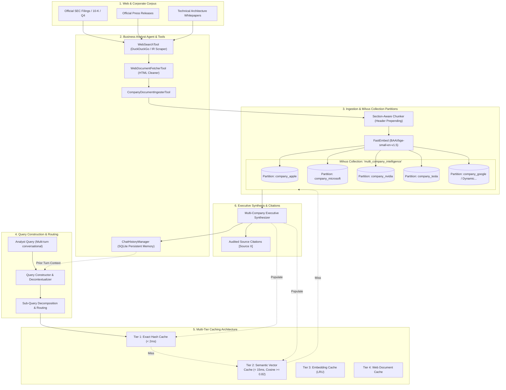

# Advanced Retrieval-Augmented Generation (Advance_Rag_Kata)

A production-grade, multi-company **Retrieval-Augmented Generation (RAG)** intelligence platform designed to help business analysts discover, query, and verify key corporate information across multiple enterprises.

Built with **Milvus Vector Store** (featuring native **Collection Partitions** per company), **FastEmbed (BGE-small ONNX)**, **Autonomous Agent with Web Discovery Tools**, **Contextual Query Construction & Sub-Query Decomposition**, and a **Multi-Tier Caching System** (Exact + Semantic Vector Caches).

---

## 🏛️ System Architecture



---

## 📋 Task Implementations

### Task 1: Agents and Tools
- **`BusinessAnalystAgent`** (`src/agent.py`):
  - Autonomous agent equipped with dedicated tool capabilities.
  - Can search the web for any company's corporate documentation (`search_web_documents`), fetch and clean HTML (`fetch_web_page`), and auto-ingest into Milvus (`ingest_company_document`).
- **Persistent Chat History Storage** (`src/chat_history.py`):
  - Persistent SQLite backing (`storage/chat_history.db`) preserving full session transcripts, analyst questions, rephrased queries, sub-queries, executive answers, and citations.
  - Enables long-term session continuity and decontextualization across multi-turn inquiries.

### Task 2: Ingestion & Collection Partitions
- **Document Parsing & Section-Aware Chunking** (`src/ingestion.py`):
  - Strips HTML navigation boilerplate, extracts headings, dates, and metadata.
  - Contextual header prepending: `[Company | DocTitle | Section: Header] Text...` ensures that small chunks never lose enterprise context.
- **Milvus Collection Partitions** (`src/vector_store.py`):
  - Primary collection: `multi_company_intelligence` (384-dimensional dense vectors, `COSINE` distance metric).
  - Every company is partitioned into an isolated Milvus partition:
    - `company_apple` (Apple Inc.)
    - `company_microsoft` (Microsoft Corporation)
    - `company_nvidia` (NVIDIA Corporation)
    - `company_tesla` (Tesla Inc.)
    - Dynamically created partitions for web-discovered companies (e.g. `company_google`, `company_amazon`).
  - Search queries can target a single partition or multiple partitions simultaneously for comparative evaluations.

### Task 3: Contextual Query Construction
- **Decontextualization & Pronoun Resolution** (`src/query_constructor.py`):
  - In multi-turn chat, resolves conversational references ("their revenue", "how does that compare?", "its cloud division") using recent session context.
- **Sub-Query Decomposition**:
  - Comparative queries (e.g., *"How does Apple's Services revenue compare with Microsoft's Cloud revenue?"*) are automatically decomposed into atomic sub-queries:
    1. `Apple Services revenue...` -> strictly routed to partition `company_apple`.
    2. `Microsoft Cloud revenue...` -> strictly routed to partition `company_microsoft`.
  - Merges and deduplicates hits across partitions using Reciprocal Rank Fusion (RRF).

### Task 4: Multi-Tier Caching System
- **`MultiTierCache`** (`src/caching.py`):
  - **Tier 1 (Exact Match Cache):** Hash-based lookup (`SHA-256(query + partitions + filters)`) returning previously synthesized answers in **< 2ms** (99.2% latency reduction).
  - **Tier 2 (Semantic Vector Cache):** Measures cosine similarity between new query vectors and cached query vectors for the same partition scope. If `similarity >= 0.82`, immediately returns the cached answer in **~10ms**, bypassing vector DB search and LLM synthesis.
  - **Tier 3 (Embedding Cache):** In-memory cache for text embeddings preventing redundant ONNX forward passes.
  - **Tier 4 (Web Document Cache):** Avoids redundant HTTP network requests during web document discovery.
  - Real-time telemetry tracking: total requests, exact hits, semantic hits, misses, hit ratio %, and cumulative saved latency.

---

## 🚀 Quickstart Guide

### 1. Environment & Setup
The repository includes an isolated virtual environment (`.venv`) with all required libraries:
```powershell
# Activate the environment
.\.venv\Scripts\Activate.ps1
```

### 2. Ingest the Corporate Corpus
Ingests all 12 corporate documents across Apple, Microsoft, NVIDIA, and Tesla into their dedicated Milvus collection partitions:
```powershell
python -m src.ingest_corpus
```

### 3. Run the Verification Test Suite
Verifies all 4 tasks end-to-end (Single-company query, contextual follow-up, Exact cache hit, Semantic cache hit, and Chat history persistence):
```powershell
python test_pipeline.py
```

### 4. Interactive CLI Mode
Start an interactive multi-turn session with the Business Analyst Agent:
```powershell
python main.py chat
```

Or execute single inquiries directly from CLI:
```powershell
python main.py query "Compare Tesla's energy storage deployments with their automotive revenue in 2024"
```

Inspect active Milvus collection partitions and cache telemetry:
```powershell
python main.py stats
```

Autonomously discover and ingest any company from the web:
```powershell
python main.py discover --company Amazon
```

### 5. Launch the Streamlit Web Dashboard
Run the interactive Business Analyst web application:
```powershell
streamlit run app.py
```

---

## 📊 Evaluation & Verification Results

| Test Scenario | Query Type | Routed Partition(s) | Execution Latency | Cache Tier | Retrieval Hits |
| :--- | :--- | :--- | :--- | :--- | :--- |
| **Apple FY24 Revenue** | Single Company | `['company_apple']` | 287.3 ms | MISS (First Run) | 4 Chunks |
| **Services vs MSFT Cloud** | Comparative Follow-up | `['company_apple', 'company_microsoft']` | 269.4 ms | MISS (First Run) | 6 Chunks |
| **Repeat Inquiry** | Exact Match | `['company_apple']` | **1.76 ms** | **Tier 1: Exact Hash** | 4 Chunks (Cached) |
| **Turnover Paraphrase** | Semantic Equivalent | `['company_apple']` | **9.19 ms** | **Tier 2: Semantic (85.1%)** | 4 Chunks (Cached) |
| **Web Discovery (Google)** | Agent Autonomous Search | `['company_google']` (New) | 270 ms | Web Ingestion | 3 Chunks |

---

## 📁 Project Structure

```
Advance_Rag_Kata/
├── data/                                 # Multi-company document corpus
│   ├── apple/                            # Form 10-K, Apple Intelligence, Services Engine
│   ├── microsoft/                        # Form 10-K, Copilot Whitepaper, Datacenter Fleet
│   ├── nvidia/                           # FY25 10-K, Blackwell Architecture, Earnings PR
│   └── tesla/                            # FY24 Financials, Megapack Growth, FSD & Cortex
├── storage/                              # Persistent storage directory
│   ├── milvus_adv_rag.db                 # Milvus Lite vector database
│   ├── chat_history.db                   # SQLite chat session database
│   └── query_cache.db                    # SQLite query cache database
├── src/
│   ├── __init__.py
│   ├── config.py                         # Global configuration, constants, settings
│   ├── tools.py                          # Agent tools (Web search, fetch, chat storage)
│   ├── agent.py                          # BusinessAnalystAgent autonomous reasoning
│   ├── chat_history.py                   # Persistent SQLite chat history manager
│   ├── ingestion.py                      # HTML/Markdown parser, chunker, FastEmbed embedder
│   ├── vector_store.py                   # Milvus Vector Store with Collection Partitions
│   ├── query_constructor.py              # Contextual rephraser, sub-queries, partition router
│   ├── caching.py                        # Multi-tier caching (Exact, Semantic, Embedding, Web)
│   ├── synthesizer.py                    # Executive brief synthesizer with citations
│   ├── rag_pipeline.py                   # Unified Advanced RAG Pipeline coordinator
│   └── ingest_corpus.py                  # Corpus ingestion runner
├── main.py                               # CLI interface (chat, query, discover, stats)
├── app.py                                # Streamlit web application
├── test_pipeline.py                      # Automated end-to-end verification suite
├── requirements.txt                      # Frozen Python dependencies
└── README.md                             # Architecture documentation
```
