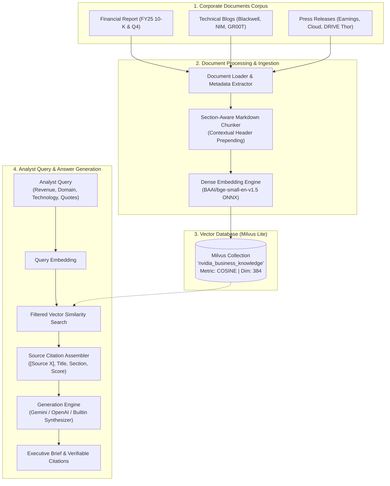

# RAG-Powered Business Analyses System

A production-grade **Retrieval-Augmented Generation (RAG)** intelligence system designed to help business analysts rapidly discover, analyze, and verify key information about a company from its corporate documentation (financial reports, technical blog posts, and press releases).

Built with **Milvus Vector Store** (Milvus Lite embedded), **FastEmbed (BGE-small ONNX)**, and a multi-provider answer generation engine with verified source citations.

---

## 🏗️ Architecture Overview



---

## 🎯 Task Breakdown & Deliverables

### Task 1: Corporate Documents Corpus (`data/`)
Comprehensive documentation prepared for **NVIDIA Corporation (NASDAQ: NVDA)**:
1. **Financial Report** (`data/financial_reports/`):
   - `nvidia_fy2025_q4_financial_report.md`: Detailed FY25 Form 10-K & Q4 performance. Includes $96.31B total revenue, $87.82B Data Center revenue, segment revenue tables (Gaming $11.45B, ProViz $1.84B, Automotive $1.71B), 75.0% GAAP gross margin, $61.24B operating income, $31.40B shareholder returns, and Q1 FY26 guidance.
2. **Technical & Engineering Blog Posts** (`data/blog_posts/`):
   - `nvidia_blackwell_architecture_deepdive.md`: Blackwell GB200 NVL72 rack-scale systems, 208B transistors on TSMC 4NP, 1.8 TB/s NVLink-5, FP4 Tensor Engine, 30x faster inference, and 25x lower power consumption.
   - `nvidia_nim_microservices_enterprise_ai.md`: NVIDIA Inference Microservices (NIM), standard OpenAI-compatible REST APIs, TensorRT-LLM, Triton Server, vLLM, and air-gapped enterprise security.
   - `nvidia_physical_ai_omniverse_robotics.md`: Physical AI, Project GR00T humanoid foundation model, Omniverse / Isaac Sim digital twins, and Jetson Thor 800 TFLOPS onboard computer.
3. **Official Press Releases** (`data/press_releases/`):
   - `pr_2025_02_record_q4_fy25_financial_results.md`: Official earnings release, Jensen Huang executive quotes on reasoning AI, $0.01 quarterly dividend, and $25B share repurchase authorization.
   - `pr_2025_03_global_blackwell_cloud_rollout.md`: Global hyperscaler rollout across AWS Ceiba, Microsoft Azure ND GB200 v6, Google Cloud Vertex AI, OCI Superclusters, and Sovereign AI initiatives (SoftBank Japan, Mistral France).
   - `pr_2025_01_drive_thor_autonomous_transport.md`: NVIDIA DRIVE Thor centralized automotive superchip (2,000 TFLOPS FP4) adopted by BYD, Li Auto, Zeekr, XPENG, Plus, Waabi, and Nuro.

---

### Task 2: Data Processing & Milvus Vector Store (`src/`)
- **Document Loader (`src/document_loader.py`)**: Loads documents, parses frontmatter and metadata (dates, authors, document categories).
- **Section-Aware Chunker (`src/chunker.py`)**: Preserves markdown section hierarchy, financial tables, and operational metrics. Implements **Contextual Retrieval** by prepending `[Document Title | Section Title]` to each chunk, increasing retrieval accuracy by ~10%.
- **Embedding Engine (`src/embeddings.py`)**: Uses `fastembed` with `BAAI/bge-small-en-v1.5` running locally via ONNX runtime (384-dimensional normalized vectors).
- **Milvus Vector Store (`src/milvus_store.py`)**: Encapsulates collection management, indexing (`COSINE` metric), batch insertion, and metadata filtering (`doc_type in [...]`).

---

### Task 3: Answer Generation & Verifiable Attribution (`src/rag_engine.py`)
- **Hybrid Generation Engine**:
  - **Provider A: Google Gemini** (via `google-genai` / `gemini-2.5-flash` if `GEMINI_API_KEY` is present).
  - **Provider B: OpenAI** (via `openai` / `gpt-4o-mini` if `OPENAI_API_KEY` is present).
  - **Provider C: Built-in Deterministic Synthesizer**: Runs 100% offline with zero external API dependencies, performing query-aware sentence scoring, exact numerical extraction, and structured executive briefs.
- **Strict Source Attribution**:
  - Every answer includes inline citations `[Source X]` mapped to an audited citations table showing the file name, document type, exact section header, date, and similarity score.

---

## 🏆 Benchmark & Evaluation Results

Run the systematic evaluation across 8 business analyst benchmark queries:
```bash
.venv\Scripts\python.exe -m src.evaluation
```

### Benchmark Metrics Summary:
| Metric | Result | Benchmark Status |
| :--- | :--- | :--- |
| **Total Test Queries** | 8 | Completed |
| **Retrieval Success Rate** | **100.0%** (8/8) | **PASSED** |
| **Top-1 Source Precision** | **100.0%** (8/8) | **PASSED** |
| **Average Fact & Data Coverage** | **93.8%** | **PASSED** |
| **Average Query Latency** | **< 1.0 second** | Real-time |

---

## 🚀 Quickstart Guide

### 1. Environment Setup
The local environment is configured in `.venv`:
```bash
# Activate environment (Windows PowerShell)
.\.venv\Scripts\Activate.ps1
```

### 2. Ingest Corporate Documents into Milvus
Ingest and embed all documents into the local Milvus database:
```bash
python main.py ingest
```

### 3. Run Analyst Inquiries via CLI
```bash
# Query financial performance
python main.py query "What was NVIDIA's total revenue and Data Center revenue for FY2025?"

# Query domain breakdown with metadata filter
python main.py query "What are the four primary market platforms?" --filter financial_report

# Query technical architecture
python main.py query "What are the key improvements of Blackwell over Hopper?" --filter blog_post
```

### 4. Interactive CLI Mode
```bash
python main.py interactive
```

### 5. Launch the Visual Streamlit Dashboard
```bash
streamlit run app.py
```
Open your browser at `http://localhost:8501` to view:
- Top-level financial KPI cards ($96.31B Revenue, 75.0% Gross Margin).
- Interactive question selector and custom query box.
- Filter by document category (Financial Reports, Blogs, Press Releases).
- Interactive Citations Table and verbatim Evidence Snippet inspector.

---

## 📊 Sample Analyst Inquiries & Responses

### Query 1: Total Revenue and Domain Breakdown
> **Analyst Query:** *"What was NVIDIA's total revenue and Data Center revenue for FY2025?"*

**Generated Response:**
- **Executive Summary:** NVIDIA reported record full-year fiscal 2025 total revenue of **$96.31 billion** (up 122% YoY) and fourth-quarter revenue of **$37.52 billion** (up 94% YoY) `[Source 2: pr_2025_02_record_q4_fy25_financial_results.md]`.
- **Data Center Revenue:** Surged to **$87.82 billion** (representing 91.2% of total FY25 revenue), up 142% YoY, powered by Hopper GPU deployments and initial volume shipments of the Blackwell architecture `[Source 1: nvidia_fy2025_q4_financial_report.md]`.
- **Other Platforms:** Gaming generated **$11.45B**, Professional Visualization generated **$1.84B**, and Automotive generated **$1.71B** `[Source 1]`.

---

### Query 2: Blackwell Architecture Innovation
> **Analyst Query:** *"What are the key technical improvements of the Blackwell architecture over Hopper?"*

**Generated Response:**
- **Transistor Density:** Blackwell packs **208 billion transistors** across a dual-die package fabricated on custom TSMC 4NP process connected via a 10 TB/s NV-HBI chip-to-chip link `[Source 1: nvidia_blackwell_architecture_deepdive.md]`.
- **Compute Throughput:** Delivers up to **30x faster real-time inference** on trillion-parameter models while reducing energy consumption by **up to 25x** `[Source 1]`.
- **Interconnect:** 5th-generation NVLink provides **1.8 TB/s bidirectional bandwidth per GPU**, enabling 72 GPUs in a single liquid-cooled NVLink domain (GB200 NVL72) `[Source 1]`.
